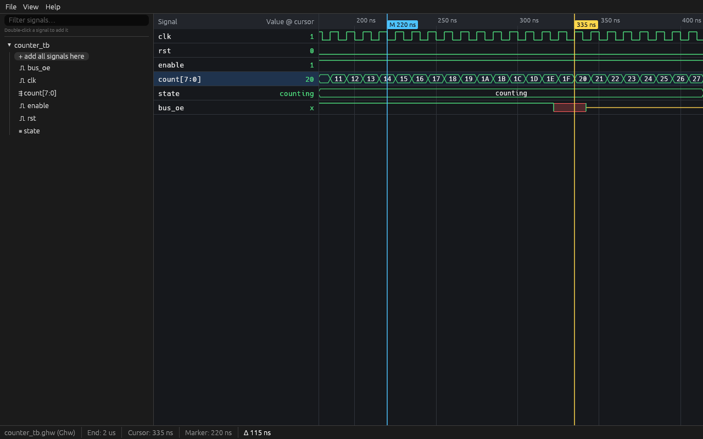

# GHDL Analyzer

A desktop waveform viewer / logic analyzer for VHDL simulations made with
[**GHDL**](https://github.com/ghdl/ghdl), written in Rust.

GHDL is an open-source VHDL simulator. It does not include a graphical viewer: it writes
the signal activity of a simulation to a waveform file (GHW, FST or VCD). GHDL Analyzer opens
those files and shows them as traces, the way a logic analyzer would.

> GHDL itself lives at **<https://github.com/ghdl/ghdl>**
> (documentation: <https://ghdl.github.io/ghdl/>). This project is a separate tool and is not
> part of GHDL.



## Features

- Opens **GHW** (GHDL's own format, keeps VHDL types), **FST** and **VCD** files.
- Design hierarchy tree with a search filter.
- 1-bit traces with distinct drawing for `X`/`U` (red), `Z` (yellow, mid-line) and weak `H`/`L`.
- Buses with the value written inside; per-signal radix: binary, hex, unsigned, signed, ASCII.
- VHDL **enumerations** (e.g. state machines) show their literal names (GHW files).
- Zoom around the mouse pointer, pan, zoom to fit.
- Cursor and marker with the time difference between them; the value of every signal at the cursor.
- Jump to the next / previous edge of the selected signal.
- Stays fast on big files: only the visible window is read, and changes closer together than
  one pixel are drawn as a single block.
- Files load on a background thread, so the window never freezes.

## Using with GHDL

Analyze, elaborate and run your testbench, asking GHDL to dump a waveform:

```bash
ghdl -a --std=08 counter.vhd counter_tb.vhd
```

```bash
ghdl -e --std=08 counter_tb
```

```bash
ghdl -r --std=08 counter_tb --stop-time=10us --wave=counter_tb.ghw
```

Then open it:

```bash
ghdl-analyzer counter_tb.ghw
```

Which format should I use?

| Option | Format | Notes |
|---|---|---|
| `--wave=file.ghw` | GHW | Recommended for VHDL: keeps enumerations, records and arrays. |
| `--fst=file.fst` | FST | Compressed; good for long simulations. |
| `--vcd=file.vcd` | VCD | Standard text format; large files. |

See GHDL's [simulation options](https://ghdl.github.io/ghdl/using/Simulation.html) for details,
for example `--read-wave-opt` to dump only some signals.

Note: some GHDL versions crash when several dump options are given in the same run; use one
format per run.

## Building

You need a recent stable Rust toolchain (<https://rustup.rs>).

```bash
cargo build --release
```

The binary is `target/release/ghdl-analyzer`. To run straight from the source tree:

```bash
cargo run --release -- examples/counter_tb.ghw
```

On Linux the GUI also needs the usual X11/Wayland libraries. On Debian/Ubuntu:

```bash
sudo apt install libxkbcommon-x11-0 libgl1 libx11-6 libxcursor1 libxrandr2 libxi6
```

## Usage

```text
ghdl-analyzer [FILE] [--show TEXT]...
```

- `FILE`: a `.ghw`, `.fst` or `.vcd` file. You can also use **File → Open** or drop a file on the window.
- `--show TEXT`: add every signal whose path contains `TEXT` at start-up (repeatable).

The app uses the GPU through wgpu and falls back to OpenGL automatically. To force one, set
`GHDL_ANALYZER_RENDERER=glow` or `GHDL_ANALYZER_RENDERER=wgpu`.

### Keyboard and mouse

| Input | Action |
|---|---|
| Mouse wheel | Zoom around the pointer |
| Shift+wheel, drag | Pan |
| Click | Place cursor |
| Shift+click, middle click | Place marker |
| `F` | Zoom to fit |
| `+` / `-` | Zoom in / out |
| `←` / `→` | Pan |
| `N` / `Shift+→` | Next edge of the selected signal |
| `P` / `Shift+←` | Previous edge of the selected signal |
| `↑` / `↓` | Select signal |
| `Delete` | Remove selected signal |
| `M` | Put marker at the cursor |
| `Home` / `End` | Go to start / end |
| Right-click a signal | Radix, move, remove |
| Drag a signal name | Reorder |

## Examples

`examples/` has small waveforms to try:

- `counter.vcd`: hand-written, with `X`, `U` and `Z` states.
- `counter_tb.ghw`, `counter_tb.fst`, `counter_tb.vcd`: produced by GHDL from
  `examples/vhdl/counter_tb.vhd`. Regenerate them with `examples/vhdl/generate.sh`
  (needs GHDL installed).

## Project layout

```text
src/
  main.rs              command line, starts the window
  app.rs               window layout, menus, background file loading
  model/               data layer, no GUI code
    mod.rs             WaveSource trait: the interface the UI reads from
    file_source.rs     WaveSource for GHW/FST/VCD files (via the `wellen` crate)
    value.rs           values and radix formatting
    time.rs            time units, axis ticks, zoom/pan math
  ui/
    hierarchy.rs       design tree
    signal_list.rs     signal names and values at the cursor
    waveform.rs        traces, time axis, cursors
tests/                 integration tests on the example files
```

The UI only talks to the `WaveSource` trait. That is how live viewing will be added later: a
`LiveSource` that receives data from a running GHDL simulation will implement the same trait.

## Roadmap

- **Phase 1 (this release):** viewer for recorded waveform files.
- **Phase 2:** live view of a running GHDL simulation, streamed through a VPI plugin
  (loaded with GHDL's `--vpi=` option) or a new GHDL runtime module.
- **Phase 3:** logic-analyzer controls: triggers, pause/step of the simulation, protocol
  decoders (UART, SPI, I²C).

Details in [ROADMAP.md](ROADMAP.md).

## Development

```bash
cargo test
```

```bash
cargo clippy --all-targets -- -D warnings
```

```bash
cargo fmt --check
```

CI runs these on Linux, Windows and macOS.

## Acknowledgements

- [GHDL](https://github.com/ghdl/ghdl), the simulator this tool is built for.
- [wellen](https://github.com/ekiwi/wellen), which reads the waveform formats.
- [egui / eframe](https://github.com/emilk/egui), the GUI toolkit.
